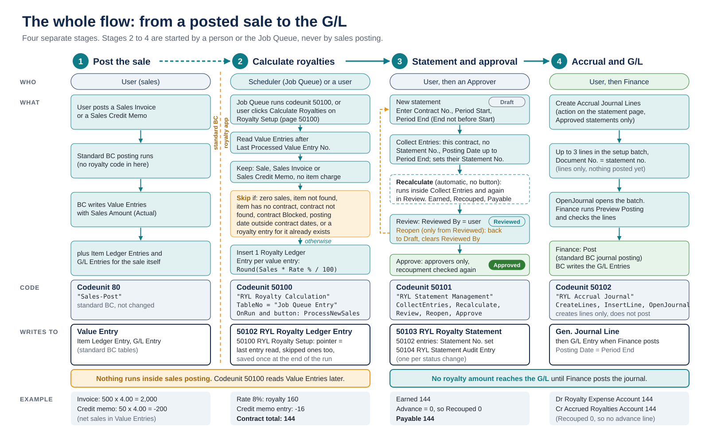
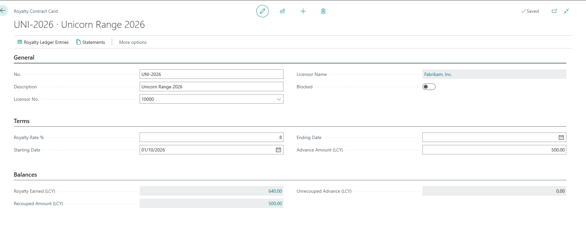
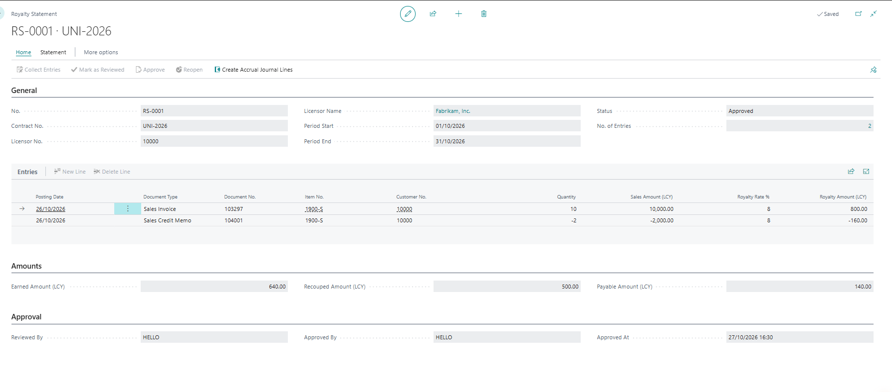
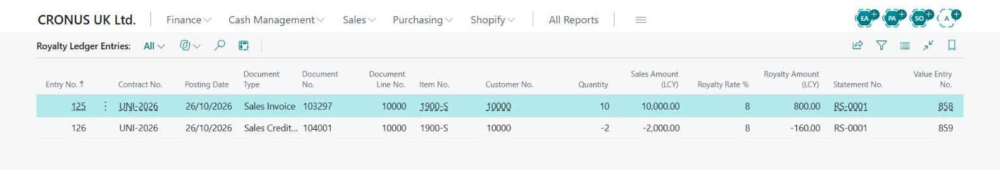
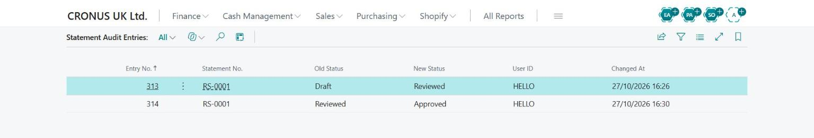
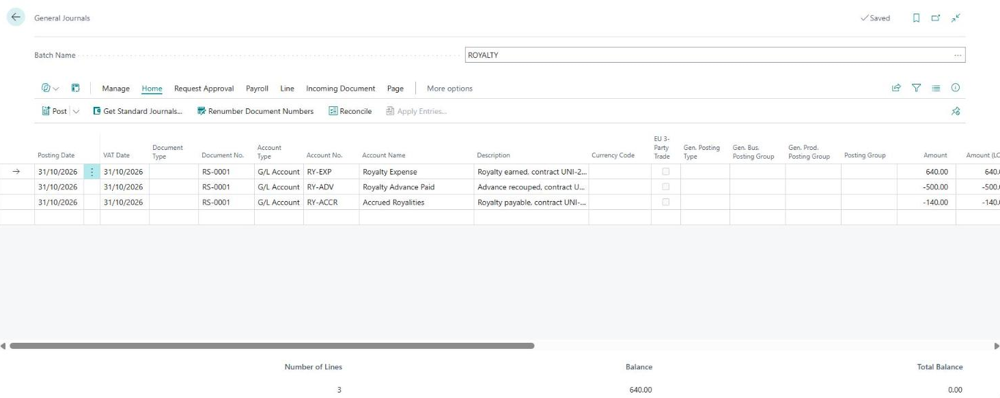
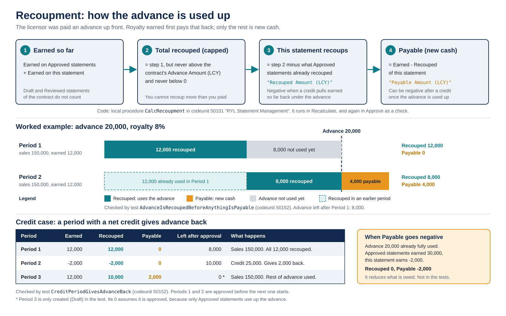
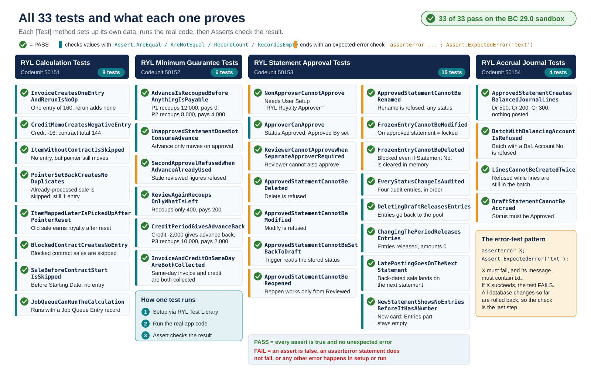
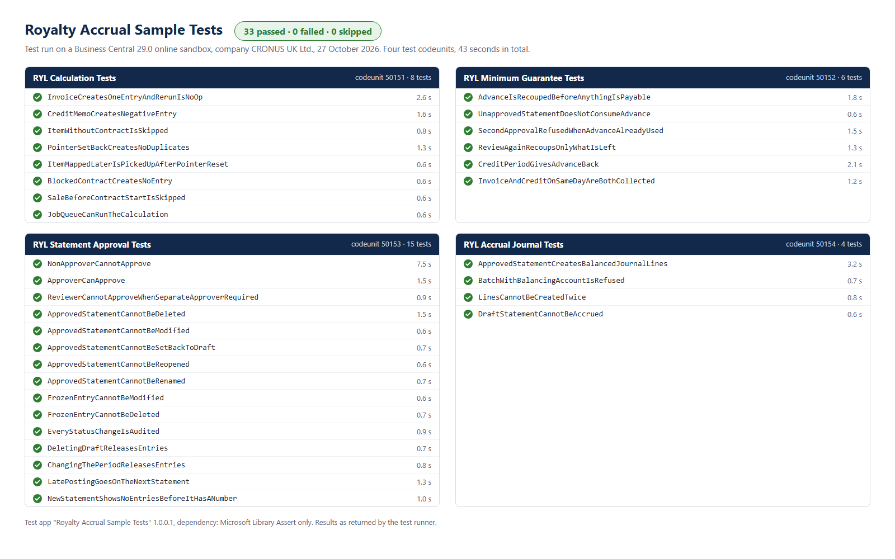

# Royalty Accrual Sample for Business Central

A small Business Central extension for a company that sells licensed merchandise and owes royalties to its licensors. It takes each royalty from the posted sale to the accrual in the G/L: calculation from posted sales invoices and credit memos, minimum guarantee recoupment, two-step approval with an audit log, and balanced journal lines that finance checks and posts.

I built it in October 2026 to a licensed-merchandise company's brief, as a sample of how I handle a finance process end to end. The company chose a packaged product, so the sample stays here as a portfolio piece.

Business Central 29, AL runtime 18.0, target Cloud, no dependencies. Objects 50100-50149, prefix RYL, permission set and translation file included. 33 automated tests in a separate test app, all passing on a BC 29.0 online sandbox. MIT licence. Status: complete as scoped and kept as a sample; issues are welcome.

*The whole flow: from a posted sale to the G/L. Stages 2 to 4 are started by a person or the Job Queue, never by sales posting.*

## What it does

1. **Contract setup.** Licensor (vendor), royalty rate, start and end date, advance (minimum guarantee). Each item points to a contract through Royalty Contract No. on the Item Card.
2. **Calculation.** A job reads the Value Entries of posted sales invoices and credit memos and writes one royalty ledger entry each: document, item, customer, quantity, net sales, rate, royalty. Each entry keeps the rate it was calculated with, so a rate change on the contract never rewrites history.
3. **Statements.** One per contract and period. Collect Entries picks up the entries, the advance is recouped first, and the statement goes Draft, Reviewed, Approved. Only a Royalty Approver can approve, every status change is logged, and an approved statement and its entries are frozen.
4. **Accounting.** An approved statement gives general journal lines (expense, advance paid, accrued payable). Finance checks them with Preview Posting and posts from the journal. Nothing is posted by code.

<table>
<tr>
<td width="50%"> Royalty Contract Card: terms and balances.</td>
<td width="50%"> An approved statement with its entries and the Earned, Recouped and Payable amounts.</td>
</tr>
<tr>
<td> Royalty Ledger Entries: one line per value entry, credit memos negative, with the statement no. filled in once a statement has collected the entry.</td>
<td> Statement Audit Entries: one row per status change, with user and time.</td>
</tr>
<tr>
<td> General Journal: the three balanced accrual lines before posting.</td>
<td>More in <a href="docs/diagrams">docs/diagrams</a>: <a href="docs/diagrams/02_calculation_flowchart.svg">calculation flowchart</a>, <a href="docs/diagrams/05_statement_lifecycle.svg">statement lifecycle</a>, <a href="docs/diagrams/08_journal_accounting.svg">journal and T-accounts</a>, <a href="docs/diagrams/09_data_model.svg">data model</a>.</td>
</tr>
</table>

## The minimum guarantee

The advance is money already paid to the licensor. Royalties earned are set against it first; only the excess is payable. The example from the tests, advance 20,000 at 8%:

| Period | Net sales | Earned | Recouped | Payable | Advance left |
|---|---|---|---|---|---|
| 1 | 150,000 | 12,000 | 12,000 | 0 | 8,000 |
| 2 | 150,000 | 12,000 | 8,000 | 4,000 | 0 |

Recoupment uses the running total for the contract: everything earned on approved statements plus this one, capped at the advance, never below zero. A period with more returns than sales therefore gives part of the advance back instead of a negative payable, and a draft shows its recoupment without moving the contract balance until it is approved.

*Recoupment: how the advance is used up, including the credit case.*

## Design decisions

Each row is a way a royalty process goes wrong, what the sample does about it, and the test in `test/src` that proves it.

| Risk | What the sample does | Test that proves it |
|---|---|---|
| Royalty code slows down or breaks sales posting | Nothing hooks into posting. Royalty Calculation (codeunit 50100) reads Value Entries afterwards, from the Job Queue or the Calculate Royalties action on Royalty Setup. There is no event subscriber anywhere in `app/src`. | None needed: there is no event subscriber in `app/src`. `JobQueueCanRunTheCalculation` covers the Job Queue path. |
| A sale counted twice after a rerun or a pointer reset, or a sale made before the item was linked never counted | One entry per value entry (item charges and non-item lines left out), a unique key on Value Entry No., Last Processed Value Entry No. kept in setup. A rerun creates nothing. Setting the pointer back picks up the old sale and skips entries that exist. | `InvoiceCreatesOneEntryAndRerunIsNoOp` `PointerSetBackCreatesNoDuplicates` `ItemMappedLaterIsPickedUpAfterPointerReset` |
| Returns ignored, royalty overstated | Credit memos give negative entries carrying the credit memo no. | `CreditMemoCreatesNegativeEntry` |
| Royalty on items or dates the contract does not cover | Items without a contract, blocked contracts and dates outside Starting Date and Ending Date are skipped. The pointer still moves on. | `ItemWithoutContractIsSkipped` `BlockedContractCreatesNoEntry` `SaleBeforeContractStartIsSkipped` |
| The licensor is paid before the advance is used up, or a credit period shows a negative payable | Recoupment on the running total per contract, capped at the advance, never below zero: a credit gives part of the advance back and payable stays at zero. Only approved statements move the contract balance. | `AdvanceIsRecoupedBeforeAnythingIsPayable` `UnapprovedStatementDoesNotConsumeAdvance` `CreditPeriodGivesAdvanceBack` |
| Two statements of one contract use the same advance | Approve recalculates the recoupment and refuses if another statement of the contract was approved since the review. Reopen and review again takes only what is left. | `SecondApprovalRefusedWhenAdvanceAlreadyUsed` `ReviewAgainRecoupsOnlyWhatIsLeft` |
| Invoice and credit memo on the same day, one of them missed | Collect Entries uses ModifyAll on the filtered set, not a loop that changes the key field it iterates on. | `InvoiceAndCreditOnSameDayAreBothCollected` |
| Approved figures changed afterwards | Approved means frozen. Modify and Delete are blocked in the table triggers of statement and entries, which read the stored record, not xRec. A statement can only be deleted while it is a Draft. Rename is never allowed, because the statement no. becomes the document no. in the G/L. Corrections go into a later period. | `ApprovedStatementCannotBeModified` `ApprovedStatementCannotBeSetBackToDraft` `ApprovedStatementCannotBeDeleted` `ApprovedStatementCannotBeRenamed` `ApprovedStatementCannotBeReopened` `FrozenEntryCannotBeModified` `FrozenEntryCannotBeDeleted` |
| Anyone can approve, or the reviewer approves their own work | Two steps. Approve needs Royalty Approver in User Setup. With Separate Approver Required in Royalty Setup the reviewer cannot approve the same statement. | `NonApproverCannotApprove` `ApproverCanApprove` `ReviewerCannotApproveWhenSeparateApproverRequired` |
| No trace of who changed a status | Every status change writes a Statement Audit Entry: old status, new status, user, time. | `EveryStatusChangeIsAudited` |
| Entries lost or stuck: a sale back-dated into an approved period, a draft that was changed or deleted | Collect Entries has no lower date limit, so a late entry lands on the next statement. Changing a draft's contract or period, or deleting it, releases its entries and clears the amounts. | `LatePostingGoesOnTheNextStatement` `DeletingDraftReleasesEntries` `ChangingThePeriodReleasesEntries` |
| A new statement lists every unassigned entry before it has a number | The Entries part shows nothing while the statement has no number, so an unsaved card never shows other contracts' entries. | `NewStatementShowsNoEntriesBeforeItHasANumber` |
| Code posts to the G/L with nobody looking | The accrual creates balanced journal lines only (expense, advance paid, accrued payable; a zero amount gets no line), posting date Period End, approved statements only. Each line's description names the contract and statement, and the statement no. is the document no., so every G/L entry traces back to its statement. Finance previews and posts. | `ApprovedStatementCreatesBalancedJournalLines` `DraftStatementCannotBeAccrued` |
| Batch settings change the entries, or the accrual is booked twice | The batch must be plain: no balancing account, no number series or posting number series, no VAT copy, so the statement no. is the document no. Refused while lines for the statement are still in the batch or G/L entries with that document no. exist. | `BatchWithBalancingAccountIsRefused` `LinesCannotBeCreatedTwice` |

In the code but not covered by a test:

- Ledger and audit entries are only written through the codeunits (indirect permissions in RYL ROYALTY), and audit entries cannot be modified or deleted at all.
- A contract with ledger entries cannot be deleted. The advance cannot be set below what approved statements have already recouped. The starting date must not be after the ending date; a blank ending date means no end.
- Concurrency guards: Royalty Setup is locked before the pointer is read, Value Entries are read with ReadCommitted isolation, the ledger is locked before Collect Entries writes, and the statement is locked before the recoupment re-check at approve.
- Royalty amounts are rounded with the Amount Rounding Precision from General Ledger Setup.

## How it was built

Between 24 and 26 October 2026, in a Business Central Online sandbox, to the brief above. The history runs one step per commit, from the contract table and item mapping to the fixes below.

Two fixes came from running it rather than reading it. The Job Queue run failed until the codeunit took a Job Queue Entry as its TableNo; `JobQueueCanRunTheCalculation` now starts it the way the queue does. Then, when the automated tests were green, I did a step-by-step acceptance run on the sandbox, Microsoft demo company, the way a finance user would work. It found a case the tests had missed: an invoice and a credit memo posted on the same day, where Collect Entries took only the first one. The loop set Statement No. while iterating a set filtered and keyed on that field, so the second entry fell out of the set. The fix was ModifyAll on the filtered set. I added `InvoiceAndCreditOnSameDayAreBothCollected` as a regression test. The same run showed that a new statement, before it had a number, listed every entry not yet on any statement, because the Entries part's link filter was still blank. The part now shows nothing until the statement has a number, and `NewStatementShowsNoEntriesBeforeItHasANumber` keeps it that way.

## Tests

`test/` is a separate app with 33 tests in four codeunits: RYL Calculation Tests (8), RYL Minimum Guarantee Tests (6), RYL Statement Approval Tests (15), RYL Accrual Journal Tests (4). It depends only on Microsoft's Library Assert, so it runs on a plain online sandbox without the full test toolkit. All 33 passed on a BC 29.0 online sandbox on 27 October 2026. Every test is named in the table above.

*All 33 tests and what each one proves.*

*The test run on the BC 29.0 online sandbox, 27 October 2026: 33 passed, 0 failed.*

Run them from the VS Code Test Explorer (AL extension) against a BC 29 sandbox: open the workspace file, publish both apps, run. The tests copy an item and a customer from the company's existing data so the posting groups are valid, create their own vendor, G/L accounts, number series and journal batch, and change Royalty Setup and your User Setup. Use a test company, never one with real data.

## Try it

1. Open `app/` in VS Code, create a launch.json for your sandbox (Download Symbols asks for one), download symbols and publish with Ctrl+F5.
2. Royalty Setup: pick a number series for statements, a general journal template and a plain batch, and the three G/L accounts.
3. Royalty Contracts: create a contract (vendor, rate, advance). On the Item Card, under Prices & Sales, set Royalty Contract No.
4. Post a sales invoice for the item, then run Calculate Royalties from Royalty Setup, or add Royalty Calculation (codeunit 50100) to the Job Queue.
5. Royalty Statements: new statement, choose contract and period, Collect Entries, Mark as Reviewed, Approve (tick Royalty Approver on your User Setup first), then Create Accrual Journal Lines and preview and post from the journal.

The actions follow the status: Collect Entries and Mark as Reviewed only in Draft, Reopen and Approve only in Reviewed, Create Accrual Journal Lines only when Approved. Contract and period can be changed only in Draft. Approve asks for confirmation, and Create Accrual Journal Lines opens the journal on the accrual batch.

## Objects

| Object | What it does |
|---|---|
| Royalty Setup (table 50100, page 50100) | Statement number series, accrual journal template and batch, G/L accounts, last processed value entry, approver option. |
| Royalty Contract (table 50101, pages 50101, 50102) | Contract terms and advance, with earned and recouped totals. |
| Royalty Ledger Entry (table 50102, page 50103) | One line per processed value entry, unique on Value Entry No. |
| Royalty Statement (table 50103, pages 50104, 50105, 50107) | Statement with status, amounts and its entries. |
| Statement Audit Entry (table 50104, page 50106) | Status change log. |
| Statement Status (enum 50100) | Draft, Reviewed, Approved. |
| Royalty Calculation (codeunit 50100) | The calculation. Can be run from the Job Queue. |
| Statement Management (codeunit 50101) | Collect, recalculate, review, reopen, approve. |
| Accrual Journal (codeunit 50102) | Journal lines for an approved statement. |
| Item, User Setup (table and page extensions) | Royalty Contract No. on the item, Royalty Approver on the user. |
| RYL ROYALTY (permission set 50100) | Rights on the sample's own objects. Give it together with a normal finance set (for example D365 BUS FULL ACCESS). |

ID range 50100-50149, tests 50150-50169, prefix RYL.

## Not in this sample

This is a sample, not a finished product. In a full implementation I would also add contract versions with dated rates, territory and channel rules, per-unit and tiered rates, foreign currency contracts, a statement layout per licensor, an exception list for sales that could not be calculated, and an import for opening balances. I left those out to keep it small.

With concurrent inventory posting on, value entry numbers can be committed out of order. Run the calculation on a schedule, not during heavy posting, or set the pointer back a little now and then; the unique key makes that safe.

## Requirements

Business Central 29 or later, AL runtime 18.0, target Cloud, no dependencies. Tested on a BC 29.0 online sandbox. Compiles clean with CodeCop, PerTenantExtensionCop and UICop (set in the workspace file), with one suppression, AA0232 on the contract's Royalty Earned (LCY) FlowField, explained in a comment. Translation file included. Every field shown on a page and every action has a tooltip, DataClassification is set on every table and table extension (EndUserIdentifiableInformation on the user fields), the code uses namespaces and using directives, and the ledger, audit and list pages are read-only. Standard tables get two fields only: Royalty Contract No. on Item, Royalty Approver on User Setup.

## About

I am Prabin Bhusal, a Business Central developer based in Nepal: AL, and C/AL before that, 3+ years, mostly finance processes, NAV to BC upgrades and API integrations (REST, payment gateways, government e-invoicing). The closest thing I had built before this was a loyalty points system on standard Business Central for a retail business in a previous role: points from posted sales by rules, a points ledger with balances, returns reversing points, the liability in the G/L.

If something is unclear or you find a bug, open an issue here. [GitHub](https://github.com/Seewulf), [LinkedIn](https://www.linkedin.com/in/prabin-bhusal-44537635b).

## Licence

MIT. Copyright (c) 2026 Prabin Bhusal. See [LICENSE](LICENSE).
